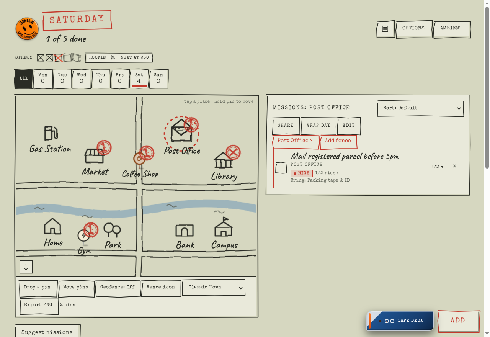
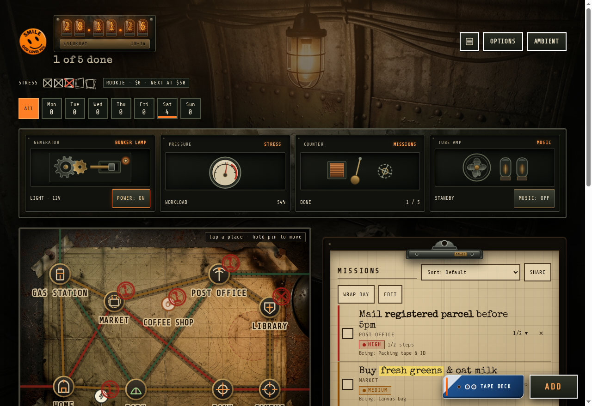
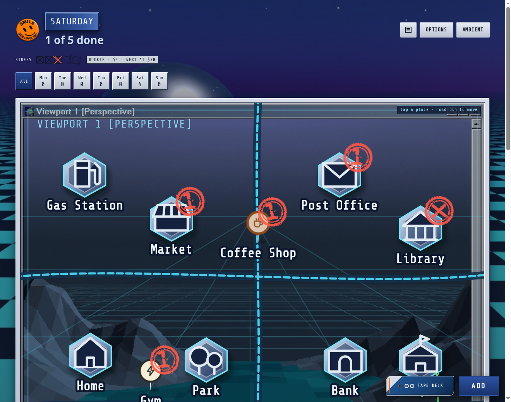
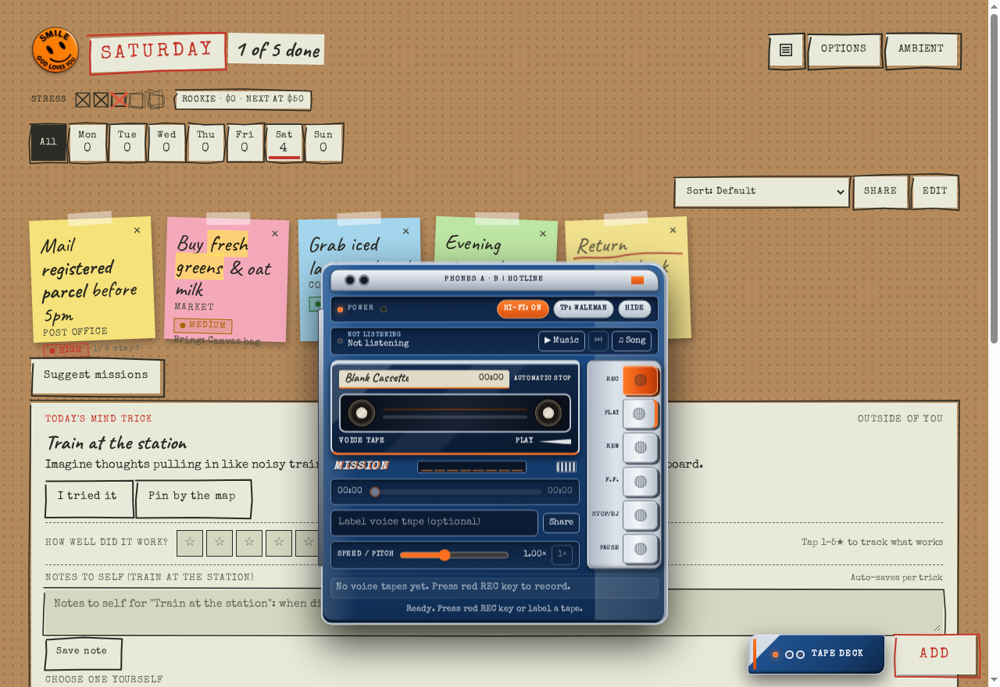
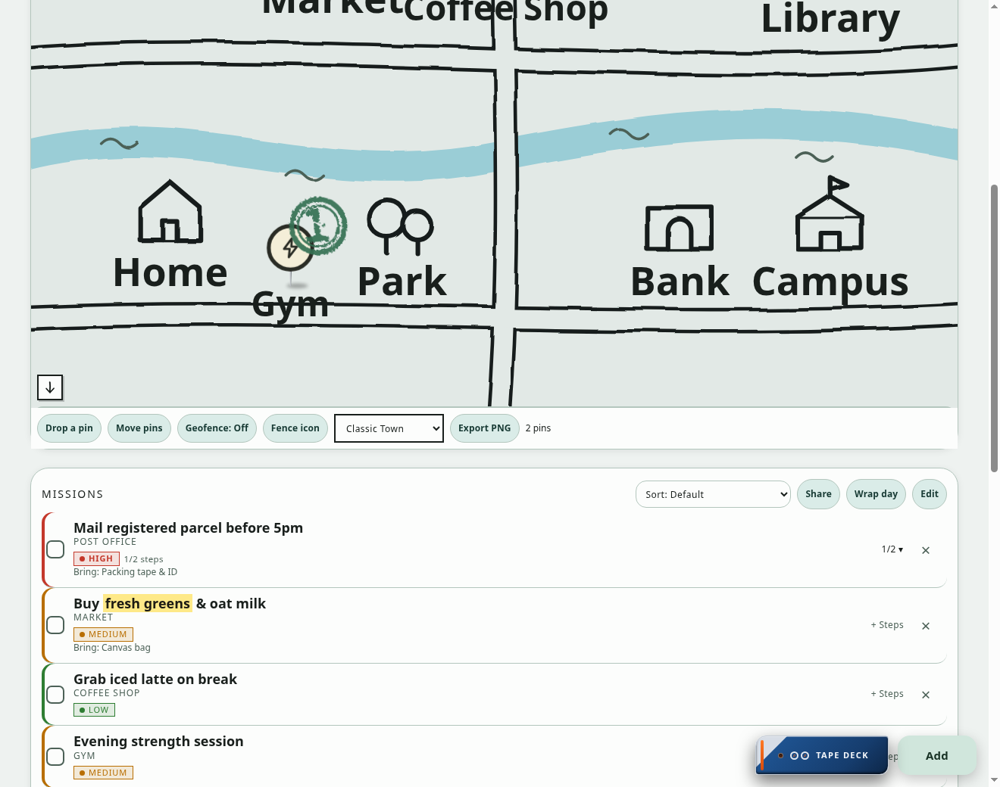
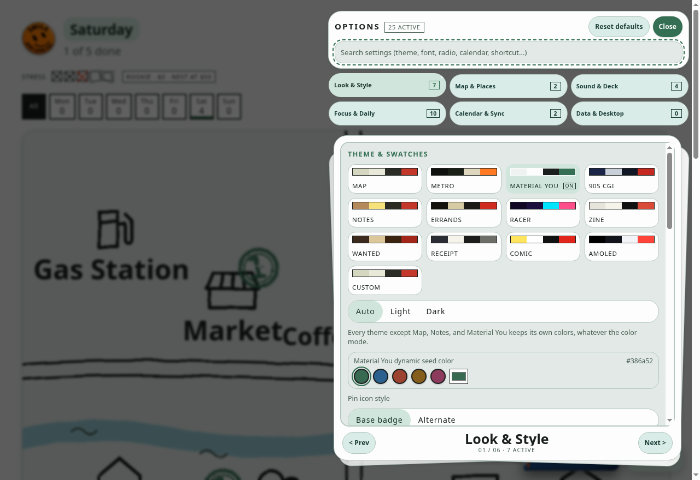

# Mission Map

**An interactive town-map errand tracker, daily planner, notebook, and retro voice cassette deck — built for Web, Windows Desktop, and Android.**

Mission Map turns your daily errands and tasks into stops across an illustrated map. Tap a landmark or drop your own custom pins to filter missions by place, jot formatted notes, record voice memos on a cassette deck or Sony Walkman, stay focused with a Pomodoro watch, and restyle the entire workspace across 13 radically different themes or your own custom texture packs.



---

## Screenshots

| Metro Bunker (Nixie Tubes & Clipboard) | 90s CGI (3D Perspective Viewport) |
| :---: | :---: |
|  |  |

| Sticky Notes & Sony Walkman Voice Deck | Material You & Mission Cards |
| :---: | :---: |
|  |  |

| Polaroid Options Deck (Themes & Swatches) |
| :---: |
|  |

---

## How to Use Mission Map

1. **Pick a stop on the map:** Tap any built-in landmark (*Home*, *Market*, *Post Office*, *Library*, *Bank*, *Gas Station*, *Campus*, *Park*) to filter the mission list to that location. Tap it again (or the red filter chip) to return to all missions.
2. **Drop custom pins:** Click **Drop a pin** below the map, tap anywhere on the canvas, name the spot (e.g., *Coffee Shop*, *Gym*), pick a symbol and color rule, and optionally attach a GPS radius. Turn on **Move pins** to drag pins around, or right-click / long-press any pin to customize it.
3. **Add missions with context:** Click **Add** (`Ctrl+N`) to create a task with a place, priority (*Low*, *Medium*, *High*), scheduled date, repeat cadence, time limit, **"Bring"** reminder, and expandable sub-steps. Inline formatting (`**bold**`, `*italic*`, `` `code` ``, `==highlight==`) works right in mission titles.
4. **Flip to Don't-do mode:** Click the round badge in the top-left corner (`Ctrl+Shift+D`) to flip between your **Do List** and a **Don't-do List** of habits to avoid.
5. **Track your day & wrap up:** Open the **Notes / Calendar / Patterns** tabs from the top bar, run focus intervals on the **Pomodoro Watch**, record quick voice reminders on the **Tape Deck**, and click **Wrap day** in the evening to rate your mood, log a reflection, and roll unfinished missions into tomorrow.

---

## Features

### Interactive Map & Location Tools
- **8 Built-in Landmarks + Smooth SVG Animations:** Landmarks and custom pins respond with subtle hover/selection scaling and landmark-specific animations (for example, the Post Office envelope lid opens to reveal a peeking letter when selected).
- **5 Map Variants:** Switch the geography between *Classic Town*, *Harbor Coast*, *Mountain Valley*, *Grid District*, and *Survey Blueprint*.
- **Up to 30 Custom Pins:** Choose from 11 vector pin symbols (*Home*, *Star*, *Cart*, *Book*, *Work*, *Heart*, *Coffee*, *Bolt*, *Flag*, *Wrench*, *Music*) or custom badge artwork, with automatic coloring by mission priority, category (*Errand*, *Home*, *Work*, *Health*, *Leisure*), or custom hex colors.
- **Smart Route & Navigation:** Sort missions by nearest stops (*Smart route*), open multi-stop directions via **Plan route**, or export a snapshot of your town map as a PNG (`Ctrl+E`).
- **Fog of War & Living Map:** Optionally hide unvisited places under drifting fog until you finish a task there, and enable moving cars/trains and day-to-night sky tinting.
- **GPS Geofencing:** Attach 50 m–1000 m geofences (from current GPS or lat/lng coordinates) to any landmark or custom pin to trigger arrival alerts—or test them indoors with *Step inside*.

### Productivity, Notes & Scheduling
- **Week Strip & Full Calendar (Month / Week / Day):** View mission counts per day, click any date to filter, and create color-coded calendar events with reminders.
- **Markdown Notebook & Corkboard Notes:** Write notes with a live formatting toolbar (`**bold**`, `*italic*`, `~~strike~~`, `==highlight==`, `# headings`, bullet lists, `- [ ]` interactive checklists, quotes, and code). Switch to the **Notes** theme to pin notes onto a tilted corkboard.
- **Pomodoro Watch (*Race the Clock*):** Configurable Focus (15–50 min), Break (3–15 min), and Loop presets with an animated circular HUD and progress strip.
- **End-of-Day Wrap & Patterns:** Review completed vs. open work, roll unfinished items to tomorrow in one click, rate daily mood (1–5), write reflections, and inspect your **Productivity Score** and detected productive hours.
- **Daily Mind-Trick Practice & Stress / Rank System:** Optional daily cognitive exercises with feedback tracking, random errand "Hassles", an escalating Stress meter, and Rookie-to-Road-King rank progression.
- **AMOLED Ambient Screen:** Always-on black idle display showing clock, next event, open missions, and stress level with configurable idle timeout and app-level brightness.

### Cassette Voice Recorder, Walkman & Built-in Radio
- **Voice Memos on Tape:** Expand the **Tape Deck** next to the **Add** button to record audio memos, label cassettes, scrub playback, adjust **Speed / Pitch** (`0.50×`–`1.75×`), toggle the **Hi-Fi analog tape filter** (warmth, saturation, and flutter), and watch live VU meters and spinning reels.
- **3 Deck Styles:** Switch between the **Realistic Shoebox Deck**, the **Sony Walkman** alternate hardware layout, or a flat **Match UI** look.
- **Built-in Theme Radio & Local Music:** Listen to 5 original looping stations (*Dusty Map FM*, *Cork Board Radio*, *Night Shift 88*, *Neon Highway*, *Pit Stop FM*) with optional humorous radio ads, or import and shuffle your own MP3/WAV/OGG/FLAC tracks.

### Sharing, Sync & Updates
- **Share Everything:** Open **Share** to copy, natively share, or download `.md` / plain-text summaries of your missions, notes, and custom pins (JSON pin data included for easy sharing), or share recorded voice tapes directly.
- **Google Calendar & Phone Calendar:** Sign in with Google for two-way event/mission sync (always previewing changes before saving), paste a read-only `.ics` iCal URL, or connect native Android device calendars.
- **JSON Backup & Restore:** Save, copy, merge, or replace all missions, events, pins, notes, and reflections via JSON.
- **Interactive 7-Step Tutorial & GitHub Auto-Update:** Replayable onboarding tour and built-in GitHub Releases checker/updater (`owner/repo`) supporting Web release notices, Android APK links, and direct Windows installer downloads.

---

## Customization

Open the **Polaroid Options Deck** (`Options` or `Ctrl+,`) to search settings or flip through 6 categorized cards:

- **13 Built-in Themes:**
  - *Map* (pencil sketch + parchment, supports Auto/Light/Dark)
  - *Metro* (underground bunker render, glowing IN-14 Nixie tube clock, mechanical dynamo/gauges, and `ОП-12` military clipboard)
  - *Material You* (dynamic tonal UI with custom seed color presets + full color picker, supports Light/Dark)
  - *90s CGI* (retro 3D perspective viewport, wireframe terrain, chrome spheres, hexagonal plinths, and beveled frames)
  - *Notes* (corkboard & sticky notes, supports Light/Dark)
  - *Errands*, *Racer*, *Zine*, *Wanted*, *Receipt*, *Comic*, *AMOLED*, and *Custom* (`www/mytheme.css`)
- **Custom Theme Packs (`.json` / `.mmpack`):**
  - Build, import, export, or load starter resource packs (inspired by Minecraft texture packs) that override colors, borders, corner radius, shadows, fonts, embedded wallpaper/paper/map/icon textures, and the cassette/Walkman shell colors, badge label, and texture.
- **Offline Typography Engine:**
  - Choose from 11 bundled `@fontsource` fonts (*Caveat*, *Special Elite*, *Share Tech Mono*, *Bangers*, *Playfair Display*, *Press Start 2P*, *Rye*, *VT323*, *Permanent Marker*, *Comic Neue*, *Anton*) with live specimen cards—applied globally or to mission titles only.
- **Tactile Effects, Custom Media & Accessibility:**
  - Upload custom wallpapers, paper textures, map backgrounds, per-theme music, sound effects, and custom Do / Don't-do pin/app icons.
  - Toggle scribble button animations, wobbly hand-drawn borders, receipt print-out entrances, animated cross-outs, tilted sticky notes, or **Reduce all motion** (`Calm` mode).

---

## Running & Building

### Web Server
```bash
npm install
npm start
```
Runs the Express server on `http://localhost:3000` (with `/api/ical-proxy` and `/api/github-release` endpoints).

### Windows Desktop (Electron)
```bash
npm run win:install
npm run win:dev     # Launch Electron desktop app
npm run win:build   # Build NSIS installer & portable .exe into desktop/dist/
```
Includes a frameless custom window, **Always-on-Top Mini Mode** (`Ctrl+Shift+M`), minimize-to-tray, dynamic taskbar/tray badges, Windows SMTC media-session readout, and global shortcuts (`Ctrl+Shift+A` quick add, `Ctrl+Shift+P` Pomodoro toggle).

### Android (Capacitor)
```bash
npm run sync        # Sync www/ into android/
npm run apk         # Build debug APK via Gradle
```
Includes native notifications, exact alarms, device calendar sync, keep-awake/brightness control for Ambient Screen, background geofence location permissions, and adaptive transparent launcher icons.

### Automated Releases (GitHub Actions)
- `.github/workflows/android.yml` builds the Android APK on pushes to `main`.
- `.github/workflows/windows.yml` builds the Windows NSIS installer and portable `.exe` on pushes to `main`.
- `.github/workflows/release.yml` builds both Android APK and Windows executables on `v*` tags (or manual dispatch) and publishes them to **GitHub Releases** for in-app auto-updates.

---

## Project Structure

```text
www/            Core web app (index.html, bundled fonts, pins, Metro & CGI textures)
desktop/        Electron wrapper, asset bundler, system tray, and Windows SMTC integration
android/        Capacitor Android project and native plugins
scripts/        Font bundling helper (build-fonts.js)
docs/           Repository screenshots
server.js       Express static server + iCal / GitHub Release API proxies
.github/        CI workflows for Android, Windows, and GitHub Releases
```
